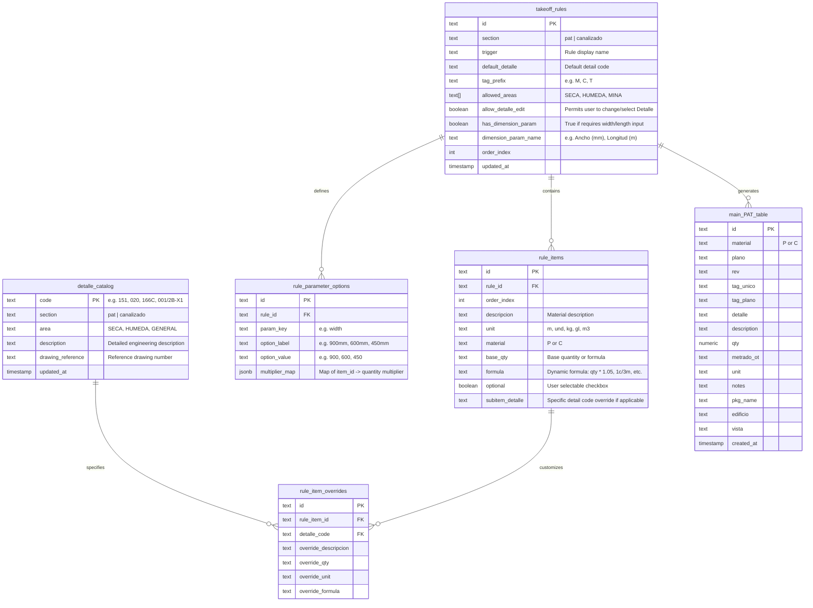
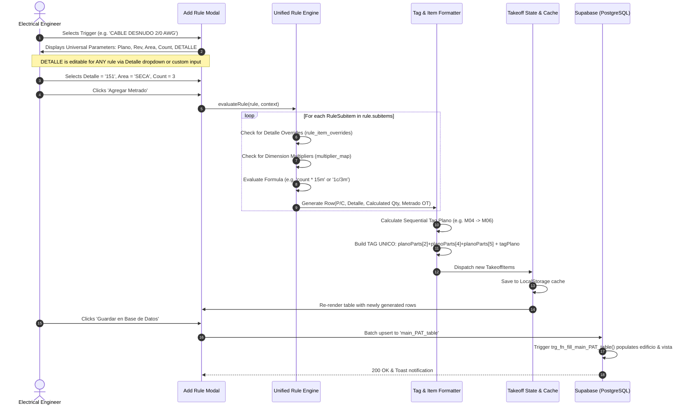
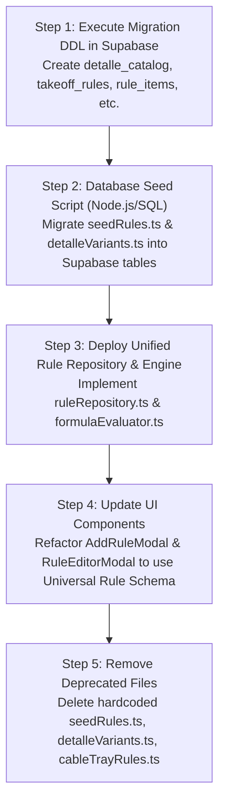

# Architecture Specification: EPC Takeoff (Unified Database-First Rule Engine)

## Executive Summary & Core Tenets

The EPC Takeoff system is transitioning from a fragmented, hardcoded client-side rule model to a **unified, database-first architecture** powered by **React + TypeScript + Vite + Supabase (PostgreSQL)**.

### Architectural Tenets
1. **Single Source of Truth (Database-First)**:
   - Zero hardcoded rule dictionaries or variant matrices in the frontend bundle.
   - All rules, details, formulas, and parameters reside in Supabase PostgreSQL tables.
   - The frontend acts as an execution engine and editing interface, loading rules dynamically with offline caching.
2. **One Universal Rule Model (Unified Handling)**:
   - There are **not** 3 different kinds of rules. There is **only 1 rule schema**.
   - Simple rules, DETALLE variant rules, and cable tray width matrix rules are all unified under a single relational / parameterized structure.
3. **Universal DETALLE Editing**:
   - Every rule in the system has a first-class `detalle` attribute that is visible, configurable, and editable in the UI.
   - DETALLE represents standard engineering drawing details (e.g., `151`, `020`, `166C`, `001/2B-X1`). Subitems can either inherit the parent rule DETALLE or define their own specific detail override.
4. **Declarative Formula & Parameter Evaluation**:
   - Dynamic calculations (`1c/3m`, width multipliers, pozo calculations) are stored as declarative expressions evaluated by a safe formula engine rather than hardcoded TypeScript `switch-case` statements.

---

## 1. Problem Analysis & Root Cause of the Legacy Architecture

### The Problem: Why Couldn't All Rules Edit DETALLE?
In the legacy codebase, rules were divided into 3 disconnected silos:
1. **`items` rules (`seedRules.ts`)**: Simple rules with a fixed list of `RuleSubitem[]`. DETALLE was either a static string or ignored, with no UI mechanism to edit or assign variants.
2. **`detalle` rules (`detalleVariants.ts`)**: A monolithic 36 KB, 670-line file hardcoding Cable 2/0 and Barra variants across Area Seca and Area Húmeda. Only these two triggers had a dedicated "DetalleVariantsModal".
3. **`cable_tray` rules (`cableTrayRules.ts`)**: A separate table and UI specifically designed around 4 hardcoded widths (`w900`, `w600`, `w450`, `w300`).

### Root Cause
- Rules were created ad-hoc as new engineering cases appeared.
- Special cases were coded as distinct types (`kind: 'items' | 'detalle' | 'cable_tray'`), leading to redundant components, inconsistent state management, and restricted editing capabilities in the UI.

### The Solution: The Unified Rule Engine
Every takeoff rule follows the exact same execution model:
$$\text{Trigger} + \text{Context Parameters (Plano, Rev, Area, Detalle, Count/Width/Length)} \longrightarrow [\text{Takeoff Items with P/C, Quantities, Metrado OT, and Tags}]$$

Whether a rule is a simple weld, an earthing well, or a complex cable tray, it is governed by this single execution pipeline.

```mermaid
flowchart LR
    subgraph InputParameters ["Input Parameters (Universal Context)"]
        P1["Plano & Rev"]
        P2["Area (Seca / Húmeda / Mina)"]
        P3["Detalle Code (e.g. 151, 020, 166C)"]
        P4["Dimension / Multiplier (Count, Length, Width)"]
    end

    subgraph UnifiedEngine ["Unified Rule Evaluation Engine"]
        Rule["Selected Takeoff Rule (from DB)"]
        ParamResolver["Parameter & Variant Resolver"]
        FormulaEngine["Safe Math/Formula Evaluator"]
        TagGen["Sequential Tag Plano & TAG UNICO Generator"]
    end

    subgraph OutputTakeoff ["Generated Takeoff Rows"]
        R1["Primary Material (P) - e.g., CABLE DESNUDO 2/0"]
        R2["Consumables (C) - e.g., GRAPA, PERNO, CONECTOR"]
        R3["Dynamic OT Rows - e.g., 1c / 3m"]
    end

    InputParameters --> UnifiedEngine
    Rule --> ParamResolver
    ParamResolver --> FormulaEngine
    FormulaEngine --> TagGen
    TagGen --> OutputTakeoff
```



---

## 2. System Overview & Deployment Topology

The application is deployed as a high-performance static SPA hosted on **Render / Vercel**, connecting directly to **Supabase** for database operations, authentication, and realtime subscriptions.

```mermaid
flowchart TD
    subgraph BrowserClient ["Client Browser (SPA)"]
        UI["React 18/19 UI Components\n(Industrial Design: Barlow Condensed & IBM Plex Mono)"]
        State["Reactive State & Cache Layer\n(Context + Stale-While-Revalidate LocalStorage/IndexedDB)"]
        Engine["Unified Rule Engine\n(Formula Evaluator & Tag Generator)"]
        SupaClient["Supabase Client (@supabase/supabase-js)"]
    end

    subgraph Host ["Hosting & CI/CD"]
        GitRepo["GitHub Repo (Ntifragility/Project_EPC-Take_off)"]
        RenderHost["Render / Vercel Static Site\n(Build: npm run build | Dir: dist)"]
    end

    subgraph SupabaseCloud ["Supabase PostgreSQL Cloud Backend"]
        DBRules[("Rules & Details Catalog\ntakeoff_rules, rule_items, detalle_catalog")]
        DBTakeoff[("Project Takeoff Data\nmain_PAT_table, planos_pat_spat, partidas")]
        Triggers["DB Triggers & Functions\ntrg_fn_fill_main_PAT_table()"]
        Realtime["Realtime Channels (WebSockets)"]
    end

    GitRepo -->|git push main| RenderHost
    RenderHost -->|Serves static bundle| BrowserClient
    UI <--> State
    State <--> Engine
    State <--> SupaClient
    SupaClient <-->|REST API (Queries & Batch Upserts)| DBRules
    SupaClient <-->|REST API (CRUD Metrados)| DBTakeoff
    SupaClient <-->|Realtime updates| Realtime
    DBTakeoff --> Triggers
```

---

## 3. Database Schema (Supabase / PostgreSQL as SSOT)

The database schema eliminates all hardcoded files (`seedRules.ts`, `detalleVariants.ts`, `cableTrayRules.ts`). Everything is stored in relational tables with Row Level Security (RLS).



### PostgreSQL DDL Implementation

```sql
-- 1. Detalle Master Catalog
CREATE TABLE IF NOT EXISTS public.detalle_catalog (
    code TEXT PRIMARY KEY,
    section TEXT NOT NULL DEFAULT 'pat',
    area TEXT NOT NULL DEFAULT 'GENERAL',
    description TEXT,
    drawing_reference TEXT,
    created_at TIMESTAMPTZ NOT NULL DEFAULT NOW(),
    updated_at TIMESTAMPTZ NOT NULL DEFAULT NOW()
);

-- 2. Unified Takeoff Rules
CREATE TABLE IF NOT EXISTS public.takeoff_rules (
    id TEXT PRIMARY KEY,
    section TEXT NOT NULL,
    trigger TEXT NOT NULL,
    default_detalle TEXT REFERENCES public.detalle_catalog(code) ON UPDATE CASCADE,
    tag_prefix TEXT NOT NULL DEFAULT 'M',
    allowed_areas TEXT[] NOT NULL DEFAULT '{"SECA","HUMEDA"}',
    allow_detalle_edit BOOLEAN NOT NULL DEFAULT TRUE,
    has_dimension_param BOOLEAN NOT NULL DEFAULT FALSE,
    dimension_param_name TEXT,
    order_index INTEGER NOT NULL DEFAULT 0,
    created_at TIMESTAMPTZ NOT NULL DEFAULT NOW(),
    updated_at TIMESTAMPTZ NOT NULL DEFAULT NOW()
);

-- 3. Rule Subitems (Bill of Materials components)
CREATE TABLE IF NOT EXISTS public.rule_items (
    id TEXT PRIMARY KEY,
    rule_id TEXT NOT NULL REFERENCES public.takeoff_rules(id) ON DELETE CASCADE,
    order_index INTEGER NOT NULL DEFAULT 0,
    descripcion TEXT NOT NULL,
    unit TEXT NOT NULL DEFAULT 'und',
    material TEXT NOT NULL CHECK (material IN ('P', 'C')),
    base_qty TEXT NOT NULL DEFAULT '1',
    formula TEXT NOT NULL DEFAULT '',
    optional BOOLEAN NOT NULL DEFAULT FALSE,
    subitem_detalle TEXT,
    created_at TIMESTAMPTZ NOT NULL DEFAULT NOW(),
    updated_at TIMESTAMPTZ NOT NULL DEFAULT NOW()
);

-- 4. Detalle-Specific Item Overrides (Replaces hardcoded detalleVariants.ts)
CREATE TABLE IF NOT EXISTS public.rule_item_overrides (
    id TEXT PRIMARY KEY DEFAULT gen_random_uuid()::text,
    rule_item_id TEXT NOT NULL REFERENCES public.rule_items(id) ON DELETE CASCADE,
    detalle_code TEXT NOT NULL REFERENCES public.detalle_catalog(code) ON UPDATE CASCADE,
    override_descripcion TEXT,
    override_qty TEXT,
    override_unit TEXT,
    override_formula TEXT,
    created_at TIMESTAMPTZ NOT NULL DEFAULT NOW()
);

-- 5. Parameter Options Matrix (Replaces hardcoded cableTrayMatrix.ts)
CREATE TABLE IF NOT EXISTS public.rule_parameter_options (
    id TEXT PRIMARY KEY DEFAULT gen_random_uuid()::text,
    rule_id TEXT NOT NULL REFERENCES public.takeoff_rules(id) ON DELETE CASCADE,
    param_key TEXT NOT NULL, -- e.g. 'width'
    option_label TEXT NOT NULL, -- e.g. '900 mm'
    option_value TEXT NOT NULL, -- e.g. '900'
    multiplier_map JSONB NOT NULL DEFAULT '{}'::jsonb
);

-- Indices for performance
CREATE INDEX IF NOT EXISTS idx_takeoff_rules_section ON public.takeoff_rules(section);
CREATE INDEX IF NOT EXISTS idx_rule_items_rule ON public.rule_items(rule_id);
CREATE INDEX IF NOT EXISTS idx_rule_item_overrides_lookup ON public.rule_item_overrides(rule_item_id, detalle_code);
CREATE INDEX IF NOT EXISTS idx_detalle_catalog_area ON public.detalle_catalog(area);

-- Enable RLS
ALTER TABLE public.detalle_catalog ENABLE ROW LEVEL SECURITY;
ALTER TABLE public.takeoff_rules ENABLE ROW LEVEL SECURITY;
ALTER TABLE public.rule_items ENABLE ROW LEVEL SECURITY;
ALTER TABLE public.rule_item_overrides ENABLE ROW LEVEL SECURITY;
ALTER TABLE public.rule_parameter_options ENABLE ROW LEVEL SECURITY;

-- Anonymous Read/Write Policies (or Authenticated role in production)
CREATE POLICY "Public Read Detalle Catalog" ON public.detalle_catalog FOR SELECT USING (true);
CREATE POLICY "Public Write Detalle Catalog" ON public.detalle_catalog FOR ALL USING (true) WITH CHECK (true);

CREATE POLICY "Public Read Takeoff Rules" ON public.takeoff_rules FOR SELECT USING (true);
CREATE POLICY "Public Write Takeoff Rules" ON public.takeoff_rules FOR ALL USING (true) WITH CHECK (true);

CREATE POLICY "Public Read Rule Items" ON public.rule_items FOR SELECT USING (true);
CREATE POLICY "Public Write Rule Items" ON public.rule_items FOR ALL USING (true) WITH CHECK (true);

CREATE POLICY "Public Read Overrides" ON public.rule_item_overrides FOR SELECT USING (true);
CREATE POLICY "Public Write Overrides" ON public.rule_item_overrides FOR ALL USING (true) WITH CHECK (true);

CREATE POLICY "Public Read Parameter Options" ON public.rule_parameter_options FOR SELECT USING (true);
CREATE POLICY "Public Write Parameter Options" ON public.rule_parameter_options FOR ALL USING (true) WITH CHECK (true);
```

---

## 4. Frontend Application Architecture

The frontend follows **Feature-Sliced Design (FSD)** principles to decouple business logic from rendering and database synchronization:

```
frontend/src/
├── app/
│   ├── App.tsx                     # Main application layout, theme & routing
│   └── providers/                  # QueryClientProvider, TakeoffProvider, ThemeProvider
├── entities/
│   ├── takeoff-rule/               # Unified Rule Entity
│   │   ├── model/
│   │   │   ├── types.ts            # Unified TypeScript types
│   │   │   ├── ruleStore.ts        # Dynamic rule catalog state & cache
│   │   │   ├── ruleEngine.ts       # Parameterized rule evaluation logic
│   │   │   └── formulaEvaluator.ts # Declarative math formula parser
│   │   └── api/
│   │       └── ruleRepository.ts   # Supabase CRUD operations for rules & items
│   ├── detalle/                    # Detalle Entity
│   │   ├── model/types.ts          # Detalle catalog types
│   │   └── api/detalleApi.ts       # Detalle catalog Supabase API
│   └── takeoff-item/               # Metrado Row Entity
│       ├── model/types.ts          # TakeoffItem, TAG UNICO generator, P/C classifier
│       └── api/takeoffApi.ts       # Supabase main_PAT_table synchronization
├── features/
│   ├── apply-rule/                 # Applying a rule to generate takeoff items
│   │   ├── ui/AddRuleModal.tsx     # Unified modal (Plano, Rev, Area, Detalle, Count)
│   │   └── model/useApplyRule.ts   # Execution pipeline hook
│   ├── edit-rule/                  # Universal Rule Editor (CRUD for ANY rule)
│   │   ├── ui/RuleEditorModal.tsx  # Universal editor: trigger, detalle, subitems, formulas
│   │   └── model/useSaveRule.ts    # Persists rule updates to Supabase
│   ├── manage-detalle/             # Engineering Detalle Catalog Management
│   │   └── ui/DetalleCatalogModal.tsx
│   └── sync-cloud/                 # Cloud sync indicators & batch upload/download
│       └── model/syncService.ts
├── widgets/
│   ├── Header/                     # Top navigation, section tabs, DB status
│   ├── TakeoffTable/               # Virtualized/paginated metrado table with inline edit
│   └── RulesCatalogue/             # Interactive table of all active rules with live edit
└── shared/
    ├── api/supabase.ts             # Supabase client singleton
    ├── lib/storage.ts              # LocalStorage fallback & offline caching
    └── ui/                         # Design system buttons, inputs, modals, badges
```

---

## 5. Domain TypeScript Types

```typescript
export type MaterialType = 'P' | 'C';
export type SectionType = 'pat' | 'canalizado';
export type AreaType = 'SECA' | 'HUMEDA' | 'GENERAL' | 'MINA';

export interface DetalleDefinition {
  code: string;
  section: SectionType;
  area: AreaType;
  description?: string;
  drawingReference?: string;
}

export interface RuleSubitem {
  id: string;
  ruleId: string;
  orderIndex: number;
  descripcion: string;
  unit: string;
  material: MaterialType;
  baseQty: string;
  formula: string;        // e.g. "qty * 1.05", "1c/3m", "count * 4.71"
  optional: boolean;
  subitemDetalle?: string; // If specific item overrides parent detail
}

export interface RuleItemOverride {
  id: string;
  ruleItemId: string;
  detalleCode: string;
  overrideDescripcion?: string;
  overrideQty?: string;
  overrideUnit?: string;
  overrideFormula?: string;
}

export interface RuleParameterOption {
  id: string;
  ruleId: string;
  paramKey: string;       // e.g. "width"
  optionLabel: string;    // e.g. "900 mm"
  optionValue: string;    // e.g. "900"
  multiplierMap: Record<string, number>; // item.id -> multiplier
}

export interface UnifiedTakeoffRule {
  id: string;
  section: SectionType;
  trigger: string;
  defaultDetalle: string;
  tagPrefix: string;
  allowedAreas: AreaType[];
  allowDetalleEdit: boolean;
  hasDimensionParam: boolean;
  dimensionParamName?: string;
  orderIndex: number;
  subitems: RuleSubitem[];
  overrides?: RuleItemOverride[];
  parameterOptions?: RuleParameterOption[];
}

export interface ApplyRuleContext {
  ruleId: string;
  pkgId: string;
  plano: string;
  rev: string;
  area: AreaType;
  detalle: string;         // Universally available for every rule
  count: number;
  selectedDimension?: string; // Optional (e.g. width 900)
  optionalItemIds: string[];  // Subitem IDs checked by user
  baseTagNumber: number;
}
```

---

## 6. Execution Pipeline: How Any Rule Produces Takeoffs



---

## 7. Universal Rule Editor: UI/UX Specification

Because all rules share a unified model, the frontend uses **one single Rule Editor** (`RuleEditorModal.tsx`):

### Fields in the Universal Rule Editor:
1. **Rule Metadata**:
   - `Section`: PAT or CANALIZADO
   - `Trigger Name`: Searchable trigger name (e.g., `SOLDADURA EXOTÉRMICA TIPO TE`)
   - `Tag Prefix`: Base prefix for tags (`M`, `C`, `T`, etc.)
   - `Allowed Areas`: Multi-select (`SECA`, `HUMEDA`, `MINA`, `GENERAL`)
2. **DETALLE Configuration**:
   - `Default Detalle Code`: Dropdown linked to `detalle_catalog` with search.
   - `Allow Detalle Edit on Takeoff`: Checkbox. If enabled, the engineer can change the Detalle when adding takeoffs.
   - `New Detalle Quick-Add`: Allows registering new drawing detail codes into the catalog directly from the modal.
3. **Subitems (Bill of Materials Table)**:
   - Dynamic table with Add/Remove/Reorder rows.
   - Columns:
     - `Material Type`: Select `P` (Principal) or `C` (Consumible)
     - `Descripción`: Material description text
     - `Unidad`: `m`, `und`, `kg`, `gl`, `m3`, etc.
     - `Base Qty / Formula`: Value or expression (e.g., `1`, `count`, `qty * 1.10`, `1c/3m`)
     - `Opcional`: Checkbox for optional materials (e.g., Tuberia PVC Ø3/4")
     - `Detalle Override`: Optional override if this specific subitem points to a distinct drawing detail.
4. **Parameter Matrix (Optional)**:
   - If the rule requires dimensional sizing (such as cable tray widths `900`, `600`, `450`, `300`), the editor provides a tab to configure dimensions and quantity multipliers without custom code.

---

## 8. Migration Plan (Zero Downtime, Lossless Transition)

To transition from the current hardcoded state to this unified architecture smoothly:



### Milestone Breakdown:
1. **Milestone 1 - DB Setup**: Execute the DDL in `schema_rules.sql` to initialize the database tables with proper foreign keys and RLS.
2. **Milestone 2 - Data Ingestion**: Run a migration script that imports existing data from `seedRules.ts` and `detalleVariants.ts` into `takeoff_rules`, `detalle_catalog`, and `rule_item_overrides`.
3. **Milestone 3 - Client Unified Engine**: Replace the fragmented `apply-rule` logic with the unified `ruleEngine.ts`.
4. **Milestone 4 - Universal Rule UI**: Update `RuleEditorModal` so any rule can edit its DETALLE, subitems, and parameters.
5. **Milestone 5 - Verification & Cleanup**: Verify end-to-end takeoff creation, export, and Supabase sync; remove legacy hardcoded files.
